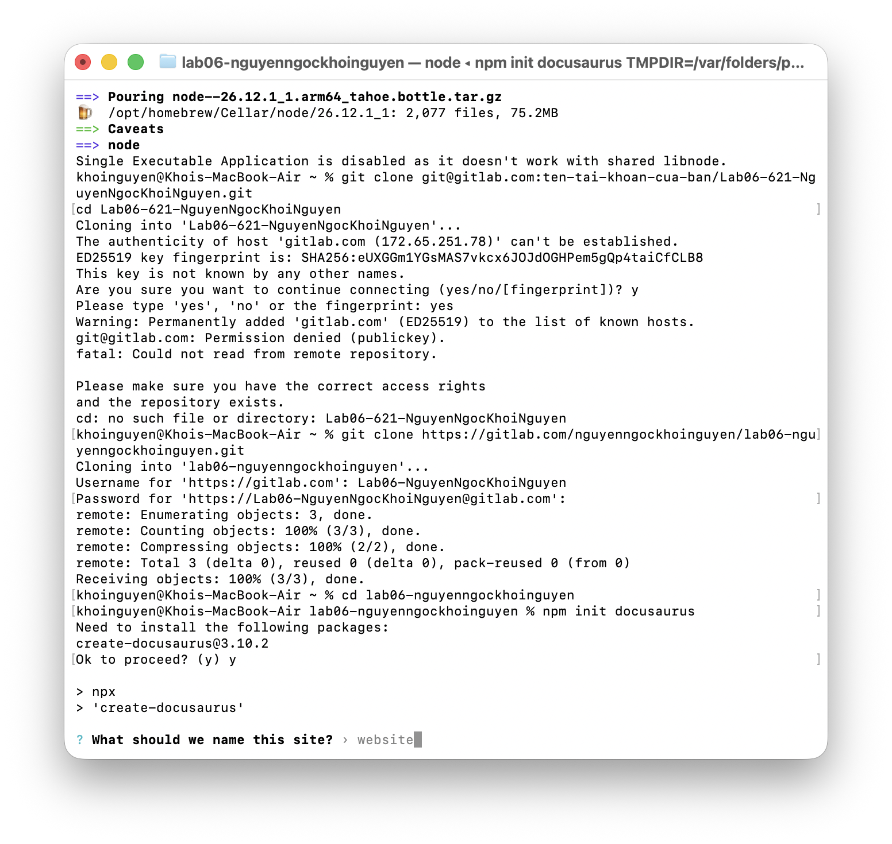
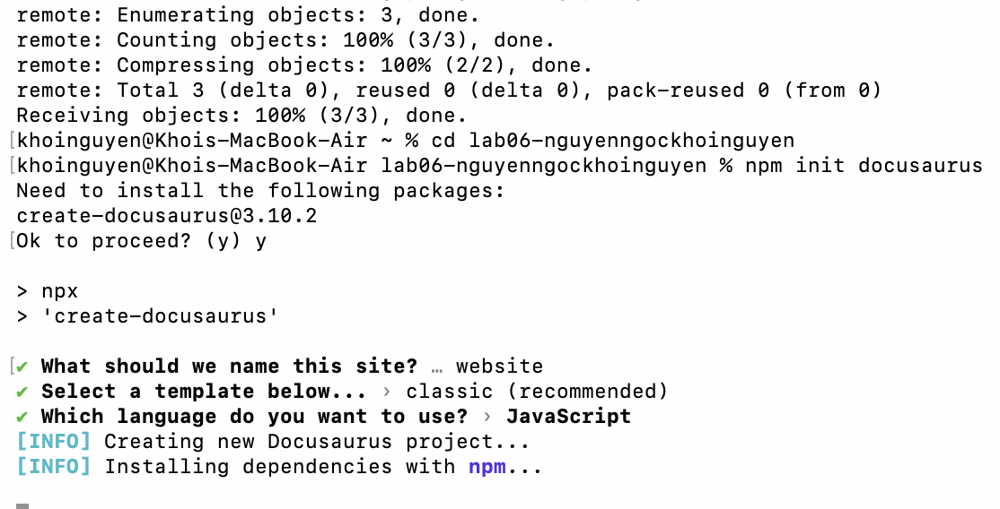
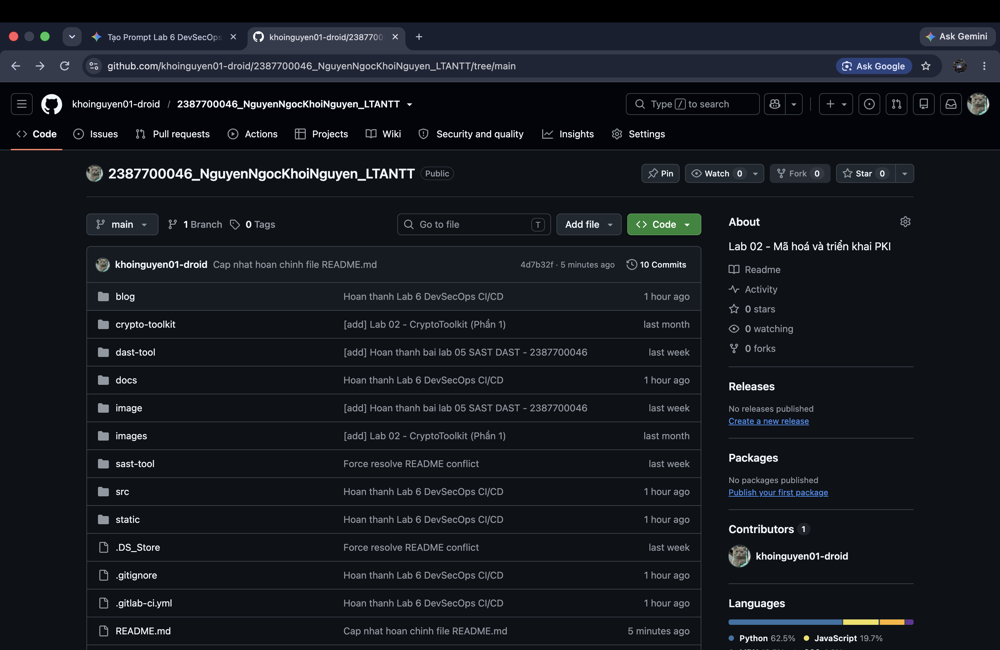
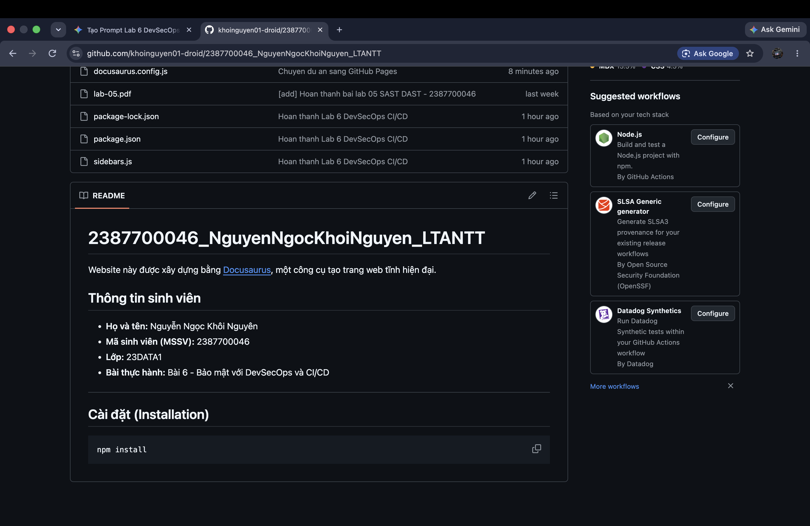
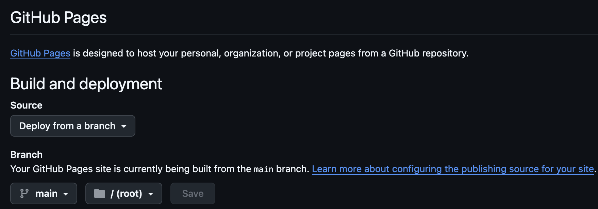
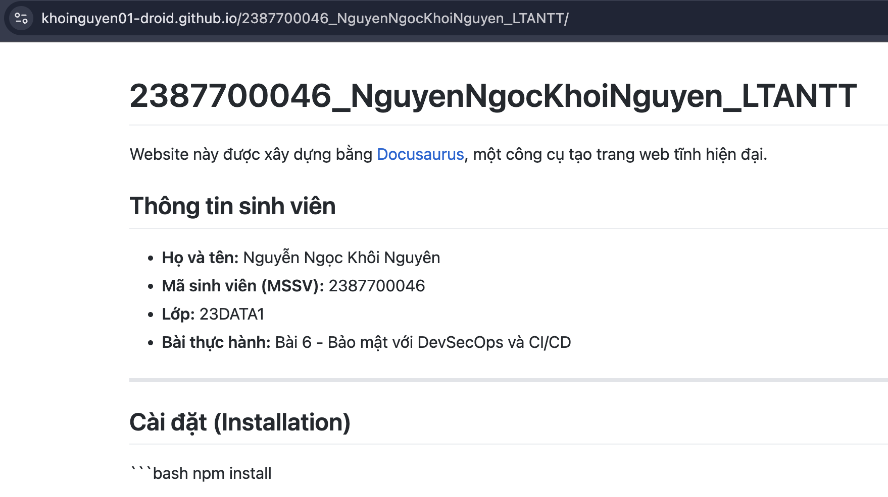
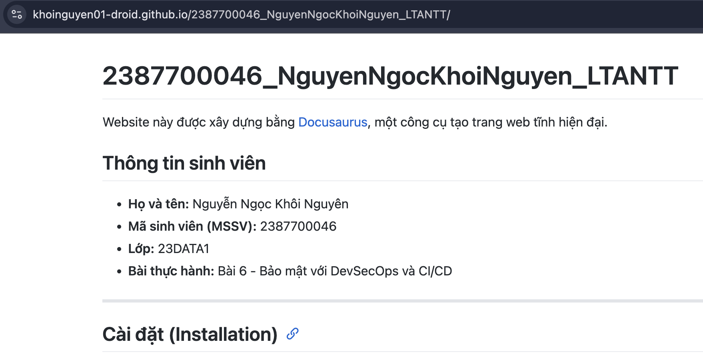

# BÁO CÁO BÀI THỰC HÀNH LAB 6: BẢO MẬT VỚI DEVSECOPS VÀ CI/CD

## 👨‍🎓 Thông tin sinh viên

| Thông tin | Chi tiết |
| :--- | :--- |
| **Họ và tên** | Nguyễn Ngọc Khôi Nguyên |
| **Mã sinh viên (MSSV)** | 2387700046 |
| **Lớp** | 23DATA1 |
| **Môn học** | Lập trình an toàn thông tin (LTANTT) |
| **Bài thực hành** | Bài 6 – Bảo mật với DevSecOps và CI/CD |

---

## 📑 MỤC LỤC

1. [Giới thiệu tổng quan](#1-giới-thiệu-tổng-quan)
2. [Môi trường và Công nghệ sử dụng](#2-môi-trường-và-công-nghệ-sử-dụng)
3. [Hệ thống hình ảnh minh chứng quá trình thực hiện](#3-hệ-thống-hình-ảnh-minh-chứng-quá-trình-thực-hiện)
4. [Đường dẫn truy cập trực tuyến](#4-đường-dẫn-truy-cập-trực-tuyến)

---

## 1. Giới thiệu tổng quan

Bài thực hành **Lab 6** tập trung vào việc xây dựng và triển khai một trang web tài liệu tĩnh bằng **Docusaurus**, sau đó tự động hóa quá trình phát hành lên **GitHub Pages** theo quy trình **CI/CD** kết hợp tư duy bảo mật **DevSecOps**. Toàn bộ quá trình được ghi lại qua 7 hình ảnh minh chứng dưới đây.

## 2. Môi trường và Công nghệ sử dụng

* **Hệ điều hành:** macOS (Apple Silicon), Terminal zsh.
* **Trình quản lý gói:** Homebrew, Node.js, npm.
* **Framework:** Docusaurus 3.10.2 (JavaScript).
* **Quản lý mã nguồn:** Git, GitHub Repository `2387700046_NguyenNgocKhoiNguyen_LTANTT`.
* **Hosting & CI/CD:** GitHub Pages (Deploy from a branch).

---

## 3. Hệ thống hình ảnh minh chứng quá trình thực hiện

### 🖼️ Hình 1 – Cài đặt môi trường và khởi tạo dự án Docusaurus

**Nội dung hình ảnh:**
Hình ảnh ghi lại quá trình cài đặt **Node.js** thông qua Homebrew (gói `node--26.12.1_1.arm64_tahoe.bottle.tar.gz`) trên máy macOS. Ngay sau đó, quá trình khởi tạo dự án Docusaurus được thực hiện bằng lệnh `npm init docusaurus`. Hệ thống hiển thị các bước tương tác:
- Cài đặt gói `create-docusaurus@3.10.2`.
- Đặt tên website: `website`.
- Chọn template: `classic (recommended)`.
- Chọn ngôn ngữ: `JavaScript`.
- Tự động cài đặt các gói phụ thuộc (dependencies).

**Ý nghĩa:** Xác nhận môi trường phát triển đã được thiết lập thành công và dự án Docusaurus được khởi tạo đúng chuẩn.

---

### 🖼️ Hình 2 – Tiến trình xử lý mã nguồn tại Local Terminal

**Nội dung hình ảnh:**
Hình ảnh thể hiện quá trình thao tác với Git trên Terminal cục bộ (cửa sổ macOS):
- Thực hiện `git clone` repository từ GitLab về máy.
- Xử lý cảnh báo xác thực SSH lần đầu: `The authenticity of host 'gitlab.com' can't be established`, nhập `yes` để thêm host vào `known_hosts`.
- Gặp lỗi `Permission denied (publickey)`.
- Chuyển sang dùng giao thức **HTTPS** để clone thành công (`git clone https://gitlab.com/...`).
- Tiếp tục chạy `npm init docusaurus` trong thư mục dự án vừa clone.

**Ý nghĩa:** Minh chứng cho kỹ năng xử lý sự cố Git/SSH và khởi tạo dự án ngay trong thư mục mã nguồn đã có.

---

### 🖼️ Hình 3 – Quản lý cấu trúc mã nguồn trên GitHub Repository

**Nội dung hình ảnh:**
Giao diện repository **`2387700046_NguyenNgocKhoiNguyen_LTANTT`** trên GitHub sau khi push thành công. Hình ảnh hiển thị:
- Cấu trúc thư mục chuẩn của Docusaurus: `blog/`, `docs/`, `src/`, `static/`, `docusaurus.config.js`, `package.json`, `sidebars.js`.
- Lịch sử commit rõ ràng với các message như: *"Hoan thanh Lab 6 DevSecOps CI/CD"*, *"Chuyen du an sang GitHub Pages"*, *"Cap nhat hoan chinh file README.md"*.
- Nội dung file `README.md` đã được cập nhật đầy đủ thông tin sinh viên.
- Bên phải là phần gợi ý workflow GitHub Actions (Node.js build & test, SLSA Generic generator).

**Ý nghĩa:** Xác nhận mã nguồn đã được đồng bộ đầy đủ, có lịch sử commit rõ ràng và sẵn sàng cho bước triển khai.

---

### 🖼️ Hình 4 – Giao diện cấu hình triển khai GitHub Pages

**Nội dung hình ảnh:**
Trang **Settings → Pages** của GitHub Repository. Hình ảnh cho thấy:
- Mục **Source** được chọn: `Deploy from a branch`.
- Thông báo: *"Your GitHub Pages site is currently being built from the `main` branch."*
- Nút **Save** được nhấn để kích hoạt quá trình build tự động.

**Ý nghĩa:** Đây là bước bật **CI/CD tự động** – mỗi khi có commit mới lên nhánh `main`, GitHub Pages sẽ tự build và xuất bản website.

---

### 🖼️ Hình 5 – Thiết lập thông số Source và Branch triển khai

**Nội dung hình ảnh:**
Cận cảnh phần cấu hình **Branch** trong GitHub Pages:
- Nhánh được chọn: `main`.
- Thư mục xuất bản: `/ (root)` – tức là thư mục gốc của repository.
- Trạng thái: đang được build từ nhánh `main`.

**Ý nghĩa:** Xác nhận thông số triển khai đã đúng: nguồn là nhánh `main`, thư mục gốc chứa mã nguồn Docusaurus đã build.

---

### 🖼️ Hình 6 – Kiểm tra trạng thái hoạt động của trang web trực tuyến

**Nội dung hình ảnh:**
Trình duyệt truy cập vào địa chỉ production:
`https://khoinguyen01-droid.github.io/2387700046_NguyenNgocKhoiNguyen_LTANTT/`

Trang web hiển thị:
- Tiêu đề: **2387700046_NguyenNgocKhoiNguyen_LTANTT**.
- Dòng mô tả: *"Website này được xây dựng bằng Docusaurus, một công cụ tạo trang web tĩnh hiện đại."*
- Phần **Thông tin sinh viên** đầy đủ (Họ tên, MSSV, Lớp, Bài thực hành).
- Mục **Cài đặt (Installation)** bắt đầu xuất hiện.

**Ý nghĩa:** Chứng minh website đã deploy thành công lên GitHub Pages và truy cập được từ Internet.

---

### 🖼️ Hình 7 – Giao diện kết quả hoàn chỉnh trên môi trường Production

**Nội dung hình ảnh:**
Giao diện hoàn chỉnh của trang web trên môi trường **Production** (góc nhìn rộng hơn Hình 6). Hình ảnh cho thấy:
- Thanh địa chỉ xác nhận domain GitHub Pages.
- Tiêu đề trang và mô tả Docusaurus hiển thị đầy đủ.
- Khối **Thông tin sinh viên**: Nguyễn Ngọc Khôi Nguyên – MSSV 2387700046 – Lớp 23DATA1 – Bài 6 DevSecOps và CI/CD.
- Phần **Cài đặt (Installation)** hiển thị khối lệnh `bash npm install` với định dạng code block chuyên nghiệp, có icon liên kết (anchor link) bên cạnh tiêu đề.

**Ý nghĩa:** Đây là minh chứng cuối cùng – website đã hoàn thiện, hiển thị đúng nội dung, đúng định dạng và sẵn sàng phục vụ mục đích báo cáo, chia sẻ tài liệu.

---

## 4. Đường dẫn truy cập trực tuyến

🌐 **Production URL:**
👉 [https://khoinguyen01-droid.github.io/2387700046_NguyenNgocKhoiNguyen_LTANTT/](https://khoinguyen01-droid.github.io/2387700046_NguyenNgocKhoiNguyen_LTANTT/)

📦 **GitHub Repository:**
👉 [https://github.com/khoinguyen01-droid/2387700046_NguyenNgocKhoiNguyen_LTANTT](https://github.com/khoinguyen01-droid/2387700046_NguyenNgocKhoiNguyen_LTANTT)

---

**Báo cáo được thực hiện bởi Nguyễn Ngọc Khôi Nguyên – MSSV: 2387700046 – Lớp 23DATA1**

*© 2026 – Lưu hành nội bộ cho mục đích học tập*

