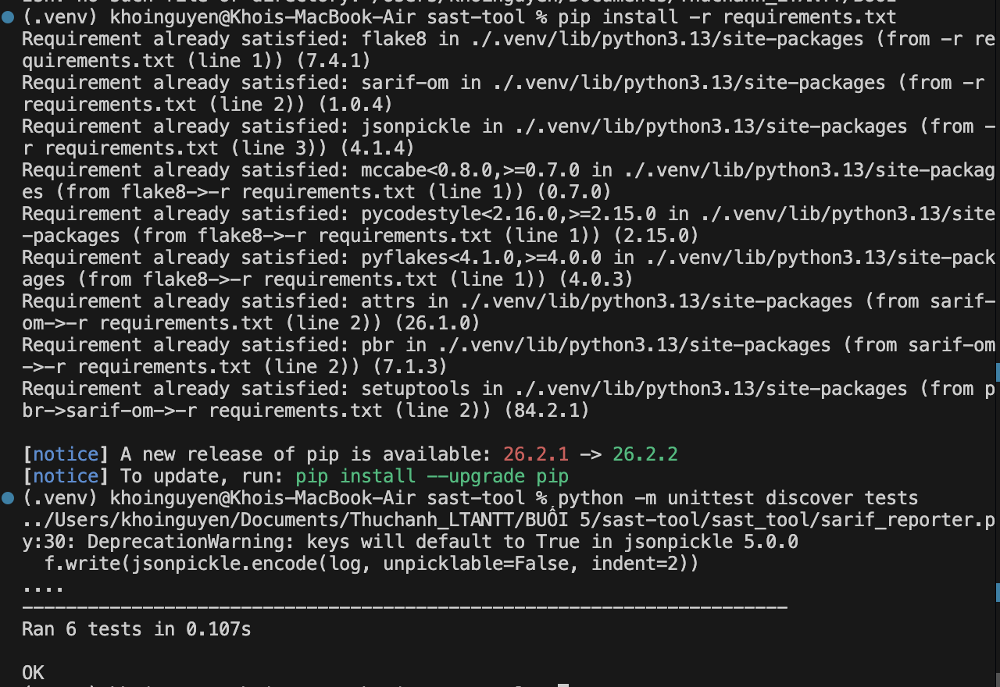
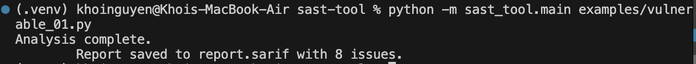
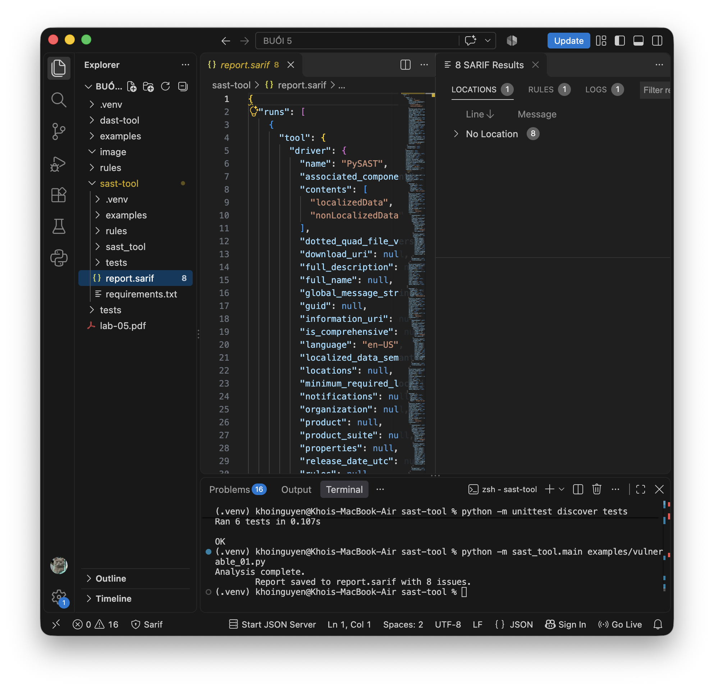
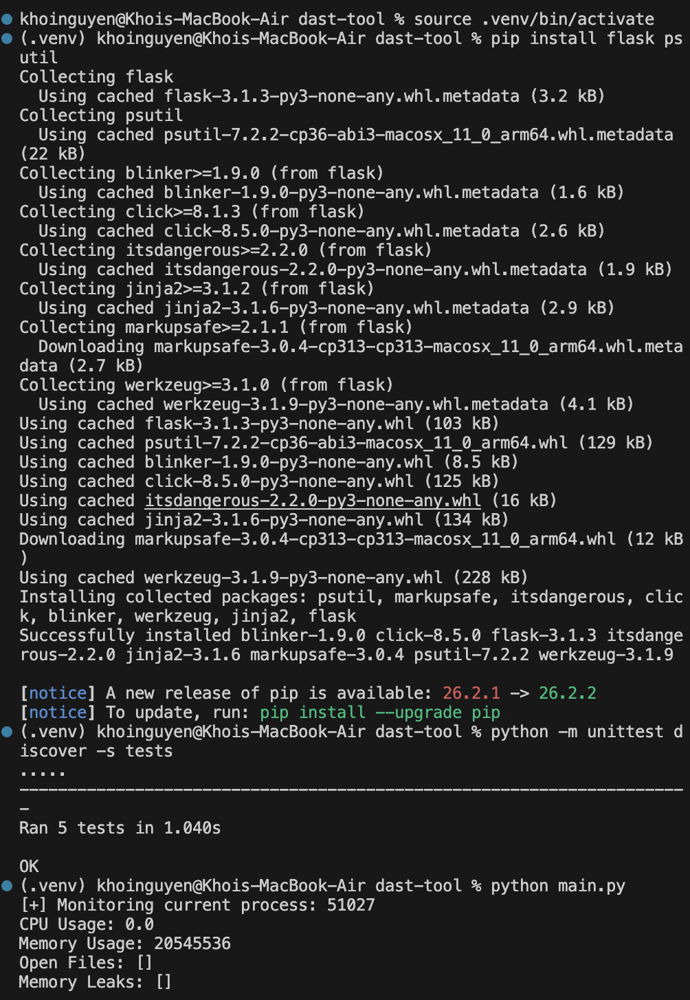
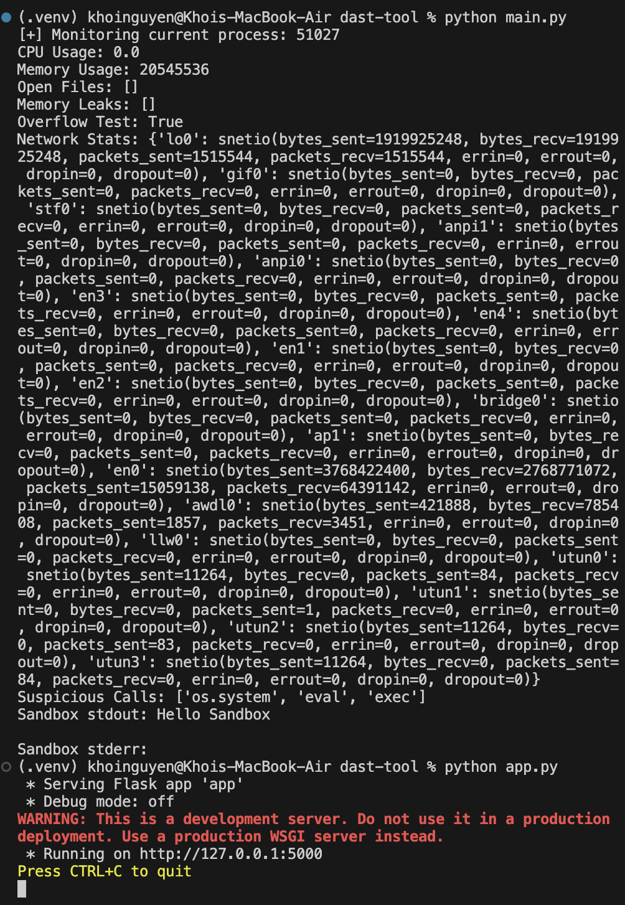
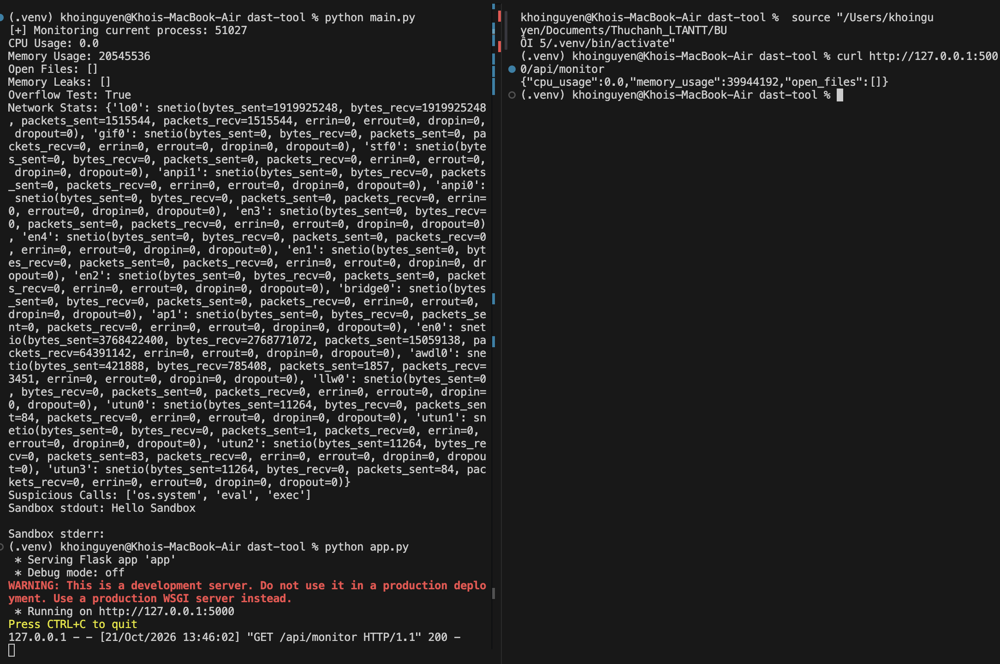
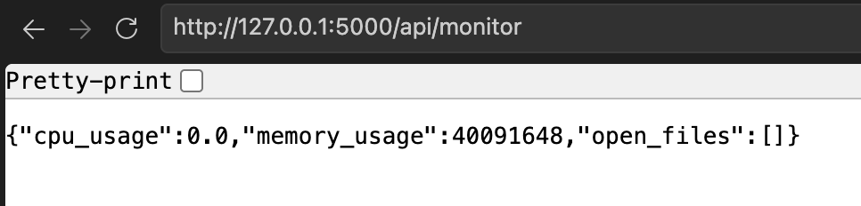
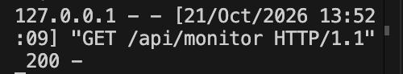
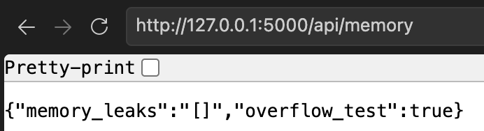
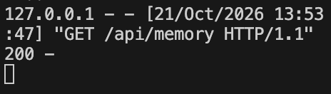

# BÁO CÁO BÀI THỰC HÀNH 05: PHÂN TÍCH VÀ KIỂM THỬ BẢO MẬT

**Họ và tên:** Nguyễn Ngọc Khôi Nguyên
**Mã sinh viên:** 2387700046
**Lớp:** 23DATA1
**Môn học:** Lập trình An ninh Thông tin

---

## PHẦN 1: STATIC ANALYSIS SECURITY TESTING (SAST)

### 1. Kết quả Unit Test
Công cụ SAST đã vượt qua toàn bộ 6 bài kiểm thử tự động (báo `OK`).

### 2. Chạy phân tích trên mã nguồn không an toàn
Thực hiện phân tích file `vulnerable_01.py`, phát hiện 8 lỗi bảo mật. Báo cáo được lưu tự động ra file `report.sarif`.

### 3. Xem báo cáo kết quả (SARIF Viewer)
Sử dụng extension SARIF Viewer trên VS Code để hiển thị chi tiết danh sách các lỗ hổng bảo mật.

---

## PHẦN 2: DYNAMIC ANALYSIS SECURITY TESTING (DAST)

### 1. Kết quả Unit Test
Nền tảng DAST vượt qua toàn bộ 5 bài kiểm thử tự động (báo `OK`).

### 2. Chạy giám sát Runtime (main.py)
Chạy kịch bản `main.py` để giám sát tài nguyên, kiểm tra rò rỉ bộ nhớ và lưu lượng mạng.

### 3. Giám sát qua Flask API (Monitor, Memory, Security, Network)
Khởi chạy server Flask và kiểm thử thành công các API `GET` thông qua trình duyệt.

**API /api/monitor:**

**API /api/memory:**

**API /api/security:**

**API /api/network:**

### 4. Kiểm thử API Sandbox (Sử dụng cURL)
Gửi lệnh POST đến `/api/sandbox` để thực thi lệnh `echo Hello Sandbox` trong môi trường cách ly.

*(Các ảnh từ 11.png đến 15.png có thể là log server hoặc các ảnh bạn chụp thêm, bạn có thể chèn thêm vào bên dưới nếu muốn)*

---
## KẾT LUẬN
Bài thực hành đã giúp phân biệt rõ ràng giữa SAST (phân tích mã nguồn tĩnh qua AST) và DAST (phân tích hành vi động qua Runtime). Đã xây dựng thành công 2 công cụ nhỏ để tự động hóa việc phát hiện lỗ hổng bảo mật.